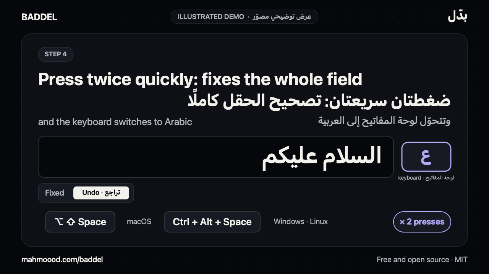

# بدّل | Baddel

[English](README.md)

«بدّل» يصحّح النص العربي أو الإنجليزي المكتوب بتخطيط لوحة مفاتيح خاطئ. إذا أردتَ كتابة `السلام عليكم` فظهرت `hgsghl ugd;l`، فاضغط اختصارًا واحدًا: يُصحَّح النص في موضعه وتتابع الكتابة. مجاني ومفتوح المصدر، لنظامَي macOS و Windows، مع نموذج أولي لنظام Linux.

**[نزِّل «بدّل» ← mahmoood.com/baddel](https://mahmoood.com/baddel/?lang=ar)**

**[شاهِد فيديو الشرح (23 ثانية)](https://mahmoood.com/baddel/?lang=ar#demo)** — عرض توضيحي مصوَّر، مع ترجمة نصية بالعربية والإنجليزية.

## الإصدارات وحالتها

| الإصدار | الحالة | محتواه |
|---|---|---|
| **0.2.0** | **منشور** (إصدار تجريبي)، وهو ما تقدّمه صفحة التنزيل. | التصحيح على macOS و Windows، واختيار تخطيط الإنجليزية والعربية، وسجل الحافظة على macOS، والتحقق من التحديثات، والنموذج الأولي لنظام Linux. |
| **0.2.1** | **مُعَدّ وغير منشور.** موجود في هذا المستودع، وينتظر مثبِّت macOS موقَّعًا وموثَّقًا. | يضيف مثبِّت macOS (‏`.pkg`)، وخيار **Open Baddel at login**، وزر **Remove Old Entry…** لحالات الترقية، وأيقونة التطبيق. |

توقيع حزم الإصدار 0.2.0 المنشور: تطبيق macOS موقَّع توقيعًا مؤقتًا (ad-hoc) و**غير موثَّق** من Apple، وتطبيق Windows **غير موقَّع رقميًا**، وأرشيف Linux غير موقَّع. لذلك يعرض macOS و Windows تحذيرًا قبل فتحها. هذه التحذيرات وسيلة نظامك لحمايتك، ولا يعطّلها «بدّل» أبدًا. قارِن بصمة SHA-256 للملف بالبصمة المعروضة في صفحة التنزيل أولًا.

حيثما وصف هذا الدليل ميزة غير موجودة في الإصدار 0.2.0، نصّ على ذلك.

## البدء السريع

1. [نزِّل](https://mahmoood.com/baddel/?lang=ar) الحزمة المناسبة لنظامك وثبِّتها (الخطوات في الأسفل).
2. شغِّل «بدّل». على macOS امنحه إذن **Accessibility** عند طلبه.
3. اكتب بالتخطيط الخاطئ سهوًا، مثل `hgsghl ugd;l`.
4. اضغط الاختصار **مرة واحدة** لتصحيح آخر كلمة، أو **مرتين بسرعة** لتصحيح الحقل كاملًا. وانقر **Undo** إن أردت التراجع.

## الاختصارات

| | الافتراضي | مكان تغييره |
|---|---|---|
| macOS | `⌥⇧Space` | أيقونة شريط القوائم ← Settings |
| Windows | `Ctrl+Alt+Space` | أيقونة منطقة الإشعارات ← Settings |
| Linux ‏(X11) | `Ctrl+Alt+Space` | الملف `~/.config/baddel/settings.json` |
| سجل الحافظة على macOS | `⌥⇧V` | — |

- **مرة واحدة:** يُصحَّح النص المحدَّد. وإن لم يكن هناك تحديد، تُصحَّح آخر كلمة قبل المؤشر.
- **مرتان خلال 300 ملّي ثانية:** يُصحَّح حقل النص كاملًا في عملية واحدة.
- **بعد التصحيح:** ينتقل «بدّل» إلى تخطيط لوحة المفاتيح المطابق إن كان مفعَّلًا في نظامك، ويعرض زر **Undo** بجوار النص. يستعيد التراجع النص الأصلي والتخطيط ما دام الحقل نفسه يحوي النص المصحَّح.

يتخطّى «بدّل» حقول كلمات المرور وكل حقل لا يستطيع قراءته والتحقق منه. راجِع [البيئات المختبَرة](docs/TESTING.md).

## التثبيت

### macOS

يتطلب macOS 13 أو أحدث، على معالجات Apple silicon أو Intel.

1. **الإصدار 0.2.0:** فُكَّ ضغط الملف وانقل `Baddel.app` إلى مجلد **Applications**. احتفظ بنسخة واحدة فقط، في Applications.
   **ابتداءً من 0.2.1:** إذا وفّر الإصدار مثبِّتًا (‏`.pkg`) فافتحه بدلًا من ذلك؛ يضع «بدّل» في Applications. لا يُنشر ملف `.pkg` إلا إذا كان موقَّعًا بهوية Apple Developer ID وموثَّقًا من Apple.
2. افتح «بدّل» من Applications. يظهر على هيئة أيقونة لوحة مفاتيح في شريط القوائم، وليست له أيقونة في Dock.
3. يفتح «بدّل» **System Settings → Privacy & Security → Accessibility**. فعِّل Baddel هناك. يحتاج هذا الإذن لتعديل النص في الحقل النشط.
4. الإصدار 0.2.0 غير موثَّق، لذلك يرفض macOS فتحه في البداية. بعد مطابقة بصمة SHA-256 يمكنك استخدام خيار Apple [لفتح تطبيق موثوق مرة واحدة](https://support.apple.com/en-us/102445).

**الترقية من إصدار تجريبي سابق.** الإصدارات التجريبية غير موقَّعة بهوية مطوِّر، فيعدّ macOS كل إصدار منها تطبيقًا مختلفًا. إذا كان Baddel مفعَّلًا في قائمة Accessibility لكنه ما زال يفيد بأن الإذن غير ممنوح، فذلك الإدخال يعود إلى النسخة القديمة:

- **الإصداران 0.2.0 و 0.1.0:** في قائمة Accessibility حدِّد Baddel واضغط زر **–**، ثم أضِف Baddel من جديد.
- **ابتداءً من 0.2.1:** انقر **Remove Old Entry…** في نافذة «بدّل»، ثم فعِّل Baddel من جديد.

**الفتح عند تسجيل الدخول (ابتداءً من 0.2.1).** Settings ← **Open Baddel at login**. الخيار معطَّل ما لم تفعّله، ويمكن إيقافه من المكان نفسه أو من **System Settings → General → Login Items**.

**إزالة التثبيت.** أغلِق «بدّل» وانقله إلى سلة المهملات. التفاصيل والملفات التي يمكن حذفها في [دليل macOS](docs/MACOS.md).

### Windows

يتطلب Windows 10 أو 11 بنسخة 64 بت. بلا مثبِّت، وبلا صلاحيات المسؤول، ولا يلزم تثبيت أي شيء آخر.

1. استخرِج محتويات ملف ZIP كاملةً إلى مجلد تحتفظ به.
2. شغِّل `Baddel.exe`. يظهر في منطقة الإشعارات بجوار الساعة.
3. انقر الأيقونة بالزر الأيمن لفتح **Settings**. جرِّب التصحيح في Notepad بالاختصار `Ctrl+Alt+Space`.

الإصدار 0.2.0 غير موقَّع رقميًا، لذلك قد يعرض Windows [تحذير SmartScreen](https://learn.microsoft.com/windows/apps/package-and-deploy/smartscreen-reputation). لإزالة «بدّل»، أغلِقه واحذف المجلد.

### Linux (نموذج أولي)

معمارية x64 وجلسة X11. استخرِج الأرشيف وشغِّل `./baddel`. يوضّح [دليل Linux](linux/README.md) المكتبات المطلوبة وإعدادات الوصول و XKB.

اختُبر النموذج في جلسة X11 آلية فقط (Ubuntu 24.04، حقل نص GTK)، ولم يُجرَّب على سطح مكتب فعلي. على Wayland لا يمكن تشغيله إلا باختصار تربطه أنت من إعدادات سطح المكتب، بلا نافذة منبثقة ولا تبديل للتخطيط، وهذا المسار غير مختبَر.

## سجل الحافظة (macOS)

ميزة اختيارية مستقلة لها اختصارها الخاص، وهي **معطَّلة إلى أن تفعّلها**.

1. افتح **Clipboard History** من أيقونة شريط القوائم، أو اضغط `⌥⇧V`.
2. فعِّل **Keep clipboard history on this Mac**. من تلك اللحظة يُدرَج ما تنسخه من نصوص وصور وملفات.
3. ابحث، وحدِّد عنصرًا وانقر **Copy**، ثم الصق بالاختصار `⌘V`.
4. عنصر الملف يشير إلى الملف الأصلي. الخيار **Keep File Copy** يحفظ نسخة تبقى حتى بعد حذف الأصل.

يُحتفَظ بما يصل إلى 100 عنصر حديث، على حاسوبك فقط. ولا تُسجَّل العناصر التي يعلّمها مصدرها بأنها مخفية أو مؤقتة، مثل كلمات المرور القادمة من مدير كلمات المرور. للمزيد: [سجل الحافظة](docs/CLIPBOARD_HISTORY.md).

## تخطيطات لوحة المفاتيح

اختر من **Settings** التخطيطات التي تكتب بها. وفعِّل التخطيطات نفسها في نظام التشغيل إن أردت أن ينتقل «بدّل» إليها.

| | الإنجليزية | العربية |
|---|---|---|
| macOS | Automatic، ‏U.S. / ABC، ‏British | Automatic، ‏Arabic، ‏Arabic – PC |
| Windows | US، ‏United Kingdom | Arabic (101)، ‏Arabic (102) |
| Linux ‏(X11) | تخطيط XKB ومتغيّره لديك | تخطيط XKB ومتغيّره لديك |

- كل جدول مأخوذ من بيانات التخطيط في نظام التشغيل نفسه. والتخطيطات المتشابهة في الاسم على أنظمة مختلفة تُعامَل كلٌّ على حدة.
- لا ينتقل «بدّل» إلا إلى التخطيط الذي استخدمه في التحويل تحديدًا. فإن لم يكن مفعَّلًا، يُصحَّح النص وتبقى لوحة المفاتيح على حالها.
- تغطي الجداول المفاتيح الـ47 في لوحة مفاتيح ANSI؛ أما المفتاح الإضافي في لوحات ISO فغير مدعوم بعد.
- **تخطيط مخصَّص:** ضع ملف تخطيط صالحًا بصيغة JSON في `~/Library/Application Support/Baddel/Layouts` (على macOS) أو `%APPDATA%\Baddel\layouts` (على Windows)، بمعرِّف يبدأ بـ `custom-`، ثم أعِد تشغيل «بدّل» واختره من Settings. يتحقق «بدّل» من الملف قبل استخدامه. الصيغة والقواعد في [دليل التخطيطات](docs/LAYOUTS.md).

## التحقق من التحديثات والخصوصية

- الخيار **Check for Updates** (أيقونة شريط القوائم على macOS، أيقونة منطقة الإشعارات على Windows، والأمر `./baddel --check-updates stable` أو `preview` على Linux) يخبرك بوجود إصدار أحدث ويفتح صفحته. «بدّل» **لا ينزّل ولا يثبّت شيئًا من تلقاء نفسه**.
- اختر **Stable releases and previews** من Settings لتُبلَّغ بالإصدارات التجريبية؛ فالإصداران المنشوران حتى الآن تجريبيان. ويتوفر تحقق يومي اختياري، وهو معطَّل افتراضيًا.
- هذا التحقق هو الطلب الشبكي الوحيد الذي يجريه «بدّل»: طلب واحد مجهول المصدر لقائمة إصدارات المشروع العامة على GitHub.
- يجري التصحيح على حاسوبك. يقرأ «بدّل» النص في الحقل النشط عند ضغطك الاختصار فقط، ولا يسجّل ضغطات المفاتيح، ولا يرسل نصّك إلى أي جهة. للمزيد: [التحديثات](docs/UPDATES.md)، [قواعد التصحيح](docs/CORRECTION_RULES.md).

## المساهمة

أنشئ تفرّعك من الفرع `main` وافتح طلبات الدمج عليه. أوامر البناء والفحوصات وطريقة تحديث الدليلين معًا في [دليل المساهمة](CONTRIBUTING.md). وثائق أخرى (بالإنجليزية): [البنية](docs/ARCHITECTURE.md)، [سجل الاختبارات](docs/TESTING.md)، [إعداد الإصدارات](docs/RELEASING.md)، [خطة التطوير](docs/ROADMAP.md).

## الترخيص

**حقوق النشر © 2026 Mahmood.** «بدّل» منشور بموجب [ترخيص MIT](LICENSE). احتفظ بإشعار حقوق النشر وإشعار الترخيص عند مشاركة نسخ من البرنامج أو أجزاء جوهرية منه.
