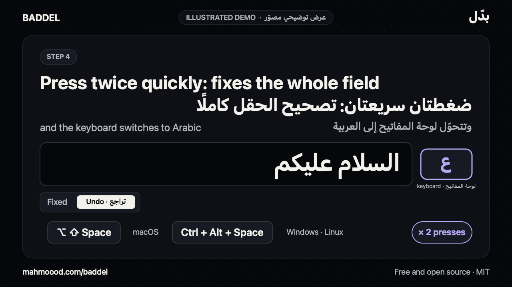

# Baddel | بدّل

[العربية](README.ar.md)

Baddel fixes Arabic or English text typed with the wrong keyboard layout. If you meant `السلام عليكم` and got `hgsghl ugd;l`, press one shortcut: the text is corrected where it is, and you keep typing. Free and open source, for macOS and Windows, with a Linux prototype.

**[Download Baddel → mahmoood.com/baddel](https://mahmoood.com/baddel/)**

**[Watch the 23-second how-to video](https://mahmoood.com/baddel/#demo)** — an illustrated demo with English and Arabic captions.

## Which version is which

| Version | Status | What it is |
|---|---|---|
| **0.2.0** | **Published** (preview). This is what the download page gives you. | Correction on macOS and Windows, a choice of English and Arabic layouts, clipboard history on macOS, update checks, and the Linux prototype. |
| **0.2.1** | **Prepared, not published.** It is in this repository and waits for a signed and notarized macOS installer. | Adds the macOS installer (`.pkg`), **Open Baddel at login**, a **Remove Old Entry…** button for upgrades, and the app icon. |

Signing of the published 0.2.0 packages: the macOS app is ad-hoc signed and **not notarized** by Apple; the Windows app is **not code-signed**; the Linux archive is unsigned. macOS and Windows will warn before opening them. Those warnings are your system protecting you, and Baddel never switches them off. Compare the file's SHA-256 with the one on the download page first.

Where this guide describes something that 0.2.0 does not have, it says so.

## Quick start

1. [Download](https://mahmoood.com/baddel/) the package for your system and install it (steps below).
2. Start Baddel. On macOS, allow **Accessibility** when it asks.
3. Type with the wrong layout by mistake, for example `hgsghl ugd;l`.
4. Press the shortcut **once** to fix the last word, or **twice quickly** to fix the whole field. Click **Undo** if you change your mind.

## Shortcuts

| | Default | Change it in |
|---|---|---|
| macOS | `⌥⇧Space` | Menu bar icon → Settings |
| Windows | `Ctrl+Alt+Space` | Tray icon → Settings |
| Linux (X11) | `Ctrl+Alt+Space` | `~/.config/baddel/settings.json` |
| macOS clipboard history | `⌥⇧V` | — |

- **Once:** fixes the selected text. With nothing selected, fixes the last word before the cursor.
- **Twice within 300 ms:** fixes the whole text field as one edit.
- **After a correction:** Baddel switches to the matching keyboard layout if it is enabled in your system, and shows **Undo** next to the text. Undo restores the original text and layout while the same field still holds the corrected text.

Baddel skips password fields and any field it cannot read and verify. See the [tested environments](docs/TESTING.md).

## Install

### macOS

Requires macOS 13 or later, Apple silicon or Intel.

1. **0.2.0:** unzip the download and move `Baddel.app` to **Applications**. Keep a single copy, in Applications.
   **From 0.2.1:** when a release offers an installer (`.pkg`), open it instead; it puts Baddel in Applications. A `.pkg` is published only when it is signed with an Apple Developer ID and notarized by Apple.
2. Open Baddel from Applications. It is a keyboard icon in the menu bar, with no Dock icon.
3. Baddel opens **System Settings → Privacy & Security → Accessibility**. Turn Baddel on there. It needs this to edit the focused text field.
4. Because 0.2.0 is not notarized, macOS will refuse to open it at first. After checking the SHA-256, you can use Apple's option to [open a trusted app once](https://support.apple.com/en-us/102445).

**Upgrading from an earlier preview.** Previews are not signed with a developer identity, so macOS treats each one as a different app. If Baddel is already switched on under Accessibility but still says access is not granted, the entry belongs to the old copy:

- **0.2.0 and 0.1.0:** in the Accessibility list, select Baddel, press **–**, then add Baddel again.
- **From 0.2.1:** click **Remove Old Entry…** in Baddel's window, then turn Baddel on again.

**Open at login (from 0.2.1).** Settings → **Open Baddel at login**. Off unless you turn it on; turn it off there or in **System Settings → General → Login Items**.

**Uninstall.** Quit Baddel and move it to the Trash. Details, including the files you can remove: [macOS guide](docs/MACOS.md).

### Windows

Requires Windows 10 or 11, 64-bit. No installer, no administrator rights, nothing else to install.

1. Extract the whole ZIP to a folder you can keep.
2. Run `Baddel.exe`. It appears in the notification area near the clock.
3. Right-click the icon for **Settings**. Try a correction in Notepad with `Ctrl+Alt+Space`.

0.2.0 is not code-signed, so Windows may show a [SmartScreen warning](https://learn.microsoft.com/windows/apps/package-and-deploy/smartscreen-reputation). To remove Baddel, exit it and delete the folder.

### Linux (prototype)

x64, X11 session. Extract the archive and run `./baddel`. The [Linux guide](linux/README.md) lists the required libraries, accessibility and XKB settings.

The prototype has only been tested in an automated X11 session (Ubuntu 24.04, GTK text field). It has not been run on a real desktop. On Wayland it can only be triggered by a shortcut you bind in your desktop's settings; there is no popup and no layout switching, and that path is untested.

## Clipboard history (macOS)

A separate, optional feature with its own shortcut. It is **off until you turn it on**.

1. Open **Clipboard History** from the menu bar icon, or press `⌥⇧V`.
2. Turn on **Keep clipboard history on this Mac**. From then on, copied text, images and files are listed.
3. Search, select an entry and click **Copy**, then paste with `⌘V`.
4. A file entry points to the original file. **Keep File Copy** stores a copy that survives deleting the original.

Up to 100 recent items are kept, on your Mac only. Items that their source marks as concealed or temporary, such as passwords from a password manager, are never recorded. More: [clipboard history](docs/CLIPBOARD_HISTORY.md).

## Keyboard layouts

Choose the layouts you type with in **Settings**. Enable the same layouts in your operating system if you want Baddel to switch to them.

| | English | Arabic |
|---|---|---|
| macOS | Automatic, U.S. / ABC, British | Automatic, Arabic, Arabic – PC |
| Windows | US, United Kingdom | Arabic (101), Arabic (102) |
| Linux (X11) | Your XKB layout and variant | Your XKB layout and variant |

- Every table comes from that operating system's own layout data. Layouts with similar names on different systems are kept separate.
- Baddel switches only to the exact layout it converted with. If that layout is not enabled, the text is still fixed and the keyboard is left as it was.
- The tables cover the 47 keys of an ANSI keyboard; the extra key of ISO keyboards is not mapped yet.
- **Custom layout:** put a valid JSON layout in `~/Library/Application Support/Baddel/Layouts` (macOS) or `%APPDATA%\Baddel\layouts` (Windows), with an id starting with `custom-`, restart Baddel and select it in Settings. Baddel checks the file before using it. Format and rules: [layout guide](docs/LAYOUTS.md).

## Update checks and privacy

- **Check for Updates** (menu bar icon on macOS, tray icon on Windows, `./baddel --check-updates stable` or `preview` on Linux) tells you whether a newer release exists and opens its page. Baddel **never downloads or installs anything itself**.
- Choose **Stable releases and previews** in Settings to hear about previews; both published versions so far are previews. A daily check is available and off by default.
- That check is the only network request Baddel makes: one anonymous request for this project's public release list on GitHub.
- Corrections happen on your computer. Baddel reads the focused text only when you press the shortcut, records no keystrokes, and sends your text nowhere. More: [updates](docs/UPDATES.md), [correction rules](docs/CORRECTION_RULES.md).

## Contribute

Fork from `main` and open pull requests against `main`. Build commands, checks and how to keep both language guides current are in [Contributing](CONTRIBUTING.md). Other documents: [architecture](docs/ARCHITECTURE.md), [testing record](docs/TESTING.md), [releasing](docs/RELEASING.md), [roadmap](docs/ROADMAP.md).

## License

**Copyright © 2026 Mahmood.** Baddel is released under the [MIT License](LICENSE). Keep the copyright and license notices when you share copies or substantial portions of the software.
