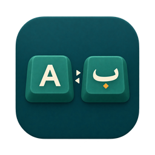

# Baddel | بدّل

**Fix text typed with the wrong keyboard layout with a shortcut.**

Baddel is an open-source utility for typing in Arabic and English. If you meant to type `عليكم` and got `ugd;l`, press the shortcut to fix the text in place and keep typing.

[Download Baddel](https://mahmoood.com/baddel/) · [Watch the quick-start video](https://mahmoood.com/baddel/#demo) · [GitHub releases](https://github.com/Mahmood83367/baddel/releases) · [العربية](README.ar.md)

## Quick start

1. Try an editable field in TextEdit or Notepad with the other language’s keyboard layout active.
2. **Press the shortcut once** to correct the selected text. With no selection, Baddel corrects the last word before the cursor.
3. **Press twice quickly** to correct the whole field. After a successful correction, Baddel can switch to the matching keyboard layout when that layout is enabled in your operating system and switching is enabled in Baddel.
4. **Click Undo** to restore the previous text and keyboard layout while the same field is active and the corrected text is intact.

| Platform | Default shortcut | Where to find Baddel |
| --- | --- | --- |
| macOS 13 or later, Apple silicon and Intel | `⌥⇧Space` | Menu bar |
| Windows 10 or 11 (x64) | `Ctrl+Alt+Space` | Notification area by the clock |
| Linux (x64), X11 prototype | `Ctrl+Alt+Space` | After starting `baddel` in your desktop session |

Baddel skips password fields and fields it cannot edit safely. [Tested environments](docs/TESTING.md) · [Correction rules](docs/CORRECTION_RULES.md)

## Download and install

Choose the package for your platform from the download page. Each release lists its signing status and SHA-256 checksum. The current public preview is `0.2.0`. The `0.2.1` macOS installer is awaiting Apple signing and notarization for public distribution. [Download page](https://mahmoood.com/baddel/) · [Current release notes](https://github.com/Mahmood83367/baddel/releases/tag/v0.2.0)

### macOS

1. Extract the `0.2.0` archive and move `Baddel.app` to **Applications**. When a release offers a signed, notarized `.pkg`, open it to install Baddel in the same location.
2. Open Baddel from **Applications**. Its icon appears in the menu bar.
3. Enable Baddel in **System Settings → Privacy & Security → Accessibility**. Baddel needs this permission to edit the focused field.

If upgrading from an older preview leaves you with a stale Accessibility entry, select Baddel in the **Accessibility** list, press **−**, then add and allow the copy in **Applications**. In `0.2.1`, the permission window also has a **Remove Old Entry…** button. macOS warns when opening the current preview because it has no Apple notarization. Verify the published checksum and follow Apple's instructions if you choose to open it. [Apple's instructions](https://support.apple.com/en-us/102445)

In Claude, ChatGPT and other Chromium-based apps, the published `0.2.0` can answer "This field isn't supported" after a restart, because those apps describe their text fields only when asked. `0.2.1` asks on the first press, which can take about a second, and its messages say why a field was refused. [Details](docs/MACOS.md#claude-chatgpt-and-other-web-based-apps)

Version `0.2.1` adds **Open Baddel at login** in Settings. Turn it on or off there or under **System Settings → General → Login Items**. [macOS guide](docs/MACOS.md)

### Windows

Extract the whole ZIP to a permanent folder and run `Baddel.exe`. The package includes the .NET runtime. Right-click the Baddel icon by the clock for Settings. SmartScreen may warn before opening the unsigned preview. [Release notes](https://github.com/Mahmood83367/baddel/releases/tag/v0.2.0)

### Linux

Extract the `x64` prototype and run `./baddel` from its folder in an X11 session. Automated testing used Ubuntu 24.04 and a GTK text field; the prototype has not been run on a real desktop yet. The limited Wayland path needs a desktop-configured shortcut and manual layout switching, and is untested. [Linux dependencies and setup](linux/README.md)

## In a terminal

The shortcut above does not reach a terminal prompt, so Baddel offers two opt-in integrations there. Neither runs a command or sends a message for you, and Baddel does not switch the keyboard layout in a terminal.

**Shell command line.** Add one line to your shell's start-up file, then open a new terminal:

| System and shell | File | Line to add |
| --- | --- | --- |
| macOS, zsh | `~/.zshrc` | `source /Applications/Baddel.app/Contents/Resources/shell/baddel.zsh` |
| Windows, PowerShell | `$PROFILE` | `. "C:\path\to\Baddel\shell\baddel.ps1"` |
| Linux, Bash | `~/.bashrc` | `source /path/to/Baddel/shell/baddel.bash` |

1. Type a command without running it.
2. **Press Baddel's shortcut once**, the same one as everywhere else, to correct the selected text, or the last word before the cursor. In Bash it is always the last word.
3. **Press it twice quickly** to correct the whole command line.
4. **Undo** with the shell's own key: `Ctrl+_` in zsh and Bash (twice in Bash after a double press), `Ctrl+Z` in PowerShell.

Baddel lets go of its shortcut while a terminal window is in front, so the shell receives it. Two exceptions: PowerShell cannot be given `Ctrl+Alt+Space` (it reads it as Space), so there the key is `Ctrl+T` unless you choose a shortcut such as `Ctrl+Shift+Space` in Baddel's Settings; and stock xterm needs `metaSendsEscape`. `Baddel --terminal-key status` says what is active on your computer.

**Claude Code's message box.** Set `VISUAL` for Claude Code to Baddel's draft command, for example in `~/.claude/settings.json`:

```json
{ "env": { "VISUAL": "/Applications/Baddel.app/Contents/MacOS/Baddel --fix-draft" } }
```

On Windows use `C:\path\to\Baddel\Baddel.exe --fix-draft`, on Linux `/path/to/Baddel/baddel --fix-draft`; the path must not contain spaces. Then press **`Ctrl+G`** in Claude Code to correct the whole unsent draft, and **`Ctrl+_`** to restore it. To use Baddel's own shortcut there too, add the entry printed by `Baddel --terminal-key claude` to `~/.claude/keybindings.json`; in macOS Terminal that also needs **Use Option as Meta key**. Claude Code hands over the whole draft only, so there is no last-word mode. Image markers such as `[Image #1]` and Claude's previous reply, when Claude Code shows it in the editor, are left as they are. Long pasted text reaches Baddel as part of the draft and can be converted with it. While this is set, `Ctrl+G` no longer opens a text editor.

These integrations are part of the next version (`0.2.1`); the published `0.2.0` packages do not include them. [Terminal guide, settings and limits](docs/TERMINAL.md)

## Clipboard history on macOS

1. Open **Clipboard History** from the menu bar or press `⌥⇧V`. Enable **Keep clipboard history on this Mac**.
2. Copy text, images, or files as usual. To retrieve an entry, open the history and choose **Copy**, then paste it in your app with `⌘V`.
3. To keep a standalone copy of a file even if you delete the original, choose **Keep File Copy**.

History stays on your Mac and holds up to 100 recent items. Use **Clear Recent** to clear those items and **Delete** to remove a saved file copy. [Clipboard history guide](docs/CLIPBOARD_HISTORY.md)

## Layouts, updates, and privacy

- **Layouts.** Settings support common Arabic and English layouts, including Arabic–PC and British on macOS and Arabic (101), Arabic (102), US and United Kingdom on Windows. You can also add a custom JSON layout file, which Baddel checks before using it. [Layout guide](docs/LAYOUTS.md)
- **Updates.** Choose **Check for Updates** from the menu on macOS or Windows, or run `./baddel --check-updates stable` on Linux. macOS and Windows can check once a day if you enable it. Choose **Stable releases and previews** in Settings to include pre-releases. The current version lets you download and install new releases manually. [Updates guide](docs/UPDATES.md)
- **Privacy.** Corrections run on your computer when you press the shortcut. Optional clipboard history stays on your Mac. Update checks contact GitHub for release information.

## Contribute and license

When you fork the repository, start from `main` and open pull requests against it. See the contributing guide for building, running the checks, and keeping the two language guides current. [Contributing](CONTRIBUTING.md) · [Packaging releases](docs/RELEASING.md)

**Copyright © 2026 Mahmood.** Baddel uses the [MIT License](LICENSE). Keep the copyright and license notices when distributing copies or substantial portions of the software.
