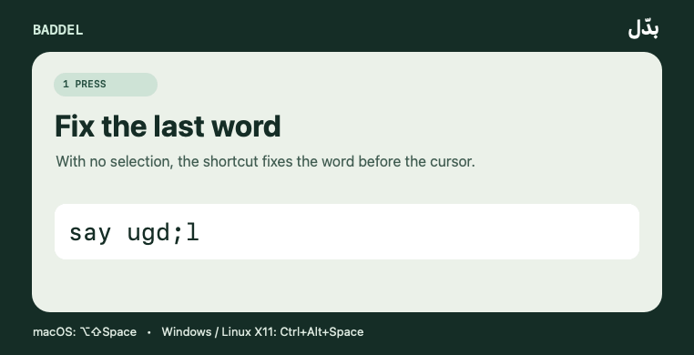

# Baddel | بدّل

[العربي](README.ar.md) · [Download page](https://mahmoood.com/baddel) · [GitHub releases](https://github.com/Mahmood83367/baddel/releases)

Baddel fixes Arabic or English text typed with the wrong keyboard layout. If you meant to type `عليكم` and got `ugd;l`, press the shortcut to fix it in place and keep typing. بدّل أداة مفتوحة المصدر لتصحيح الكتابة بين الكيبورد العربي والإنكليزي.

## Correct what you typed

- **Press once.** Baddel fixes the selection, or the last word before the cursor if you haven't selected anything.
- **Press twice quickly.** Baddel fixes the current text field as one edit. The default double-press window is 300 ms.
- **Keep typing or undo.** After verifying the edit, Baddel switches to the matching keyboard if it's enabled in your system. Click **Undo** to restore the original text and layout while the corrected field still has focus and its text is unchanged.

| Platform | Default shortcut | Where to find Baddel |
| --- | --- | --- |
| macOS 13+ (Apple silicon and Intel) | `⌥⇧Space` | Keyboard icon in the menu bar |
| Windows x64 | `Ctrl+Alt+Space` | Notification area near the clock |
| Linux x64 prototype, X11 | `Ctrl+Alt+Space` | Start `baddel` in your desktop session |

Use a supported, editable text field. Baddel skips password fields and fields it can't safely modify. See the [tested environments](docs/TESTING.md) for application coverage.

## Download and install

Get the matching archive from [GitHub releases](https://github.com/Mahmood83367/baddel/releases). The [download page](https://mahmoood.com/baddel) lists the current packages for each platform with their checksums. Check the release notes for signing status and the corresponding SHA-256 file. The `0.1.0` preview contains macOS and Windows correction. This guide also covers the clipboard, additional layouts, and Linux in newer builds.

### macOS

1. **Install.** Use the installer (`.pkg`) when a release offers one: open it and it puts Baddel in **Applications**. A `.pkg` is only published when it is signed with an Apple Developer ID and notarized by Apple. Otherwise unzip the macOS universal archive and move `Baddel.app` to **Applications** yourself. Keep one copy, in Applications.
2. **Open Baddel** from Applications. It lives in the menu bar as a keyboard icon and has no Dock icon.
3. **Grant Accessibility.** Baddel shows a window that opens **System Settings → Privacy & Security → Accessibility**. Turn Baddel on there. It uses that access to edit the focused text field.
4. **Try it.** Type a test word with the wrong keyboard enabled and press `⌥⇧Space`.

**Upgrading from an earlier preview.** Earlier previews were not signed with a developer identity, so macOS treats each of them as a different app. If Baddel is already listed and switched on under Accessibility but its window still says access is not granted, click **Remove Old Entry…** in that window, then turn Baddel on again. Delete old copies you kept outside Applications.

**Open at login (optional).** Menu bar icon → **Settings** → **Open Baddel at login**. It is off unless you turn it on, and only works for the copy in Applications. Turn it off in the same place or under **System Settings → General → Login Items**.

**Uninstall.** Turn off **Open Baddel at login**, quit Baddel, and move it from Applications to the Trash. The [macOS guide](docs/MACOS.md) lists the settings and history files you can also remove.

For a build without Apple notarization, which includes the `0.1.0` and `0.2.0` previews, check its published SHA-256 before deciding to use Apple's option to [open a trusted app once](https://support.apple.com/en-us/102445).

### Windows

1. Extract the whole Windows x64 ZIP to a folder you can keep.
2. Run `Baddel.exe`. The portable package includes its .NET runtime.
3. Right-click the icon by the clock to open **Settings**. Try a correction in Notepad with `Ctrl+Alt+Space`.

For an unsigned preview, check the release notes and SHA-256. Windows may show a [SmartScreen warning](https://learn.microsoft.com/windows/apps/package-and-deploy/smartscreen-reputation).

### Linux

Download the Linux x64 archive when it's listed under the release assets. Extract it and run `./baddel` from its folder in an X11 desktop session. Follow the [Linux setup guide](linux/README.md) for dependencies, accessibility, and XKB settings.

The prototype passed its X11 tests on Ubuntu 24.04 with a GTK text field in automated CI. It hasn't been run on a real desktop yet. Wayland has a desktop-bound trigger path, with manual layout switching and command-line Undo. Wayland desktop behavior still needs testing.

## Choose your Arabic and English layouts

Open **Settings** on macOS or Windows. Pick the layouts you type with and set a shortcut that suits you. Enable the same input sources in your operating system if you want Baddel to switch between them.

| Platform | Arabic | English |
| --- | --- | --- |
| macOS | Automatic, Arabic, Arabic–PC | Automatic, U.S. / ABC, British |
| Windows | Arabic (101), Arabic (102) | US, United Kingdom |
| Linux X11 | Your configured Arabic XKB layout and variant | Your configured English XKB layout and variant |

For an advanced manual mapping, use the verified JSON layout format from [`shared/layouts/`](shared/layouts/). On macOS put a valid custom layout in `~/Library/Application Support/Baddel/Layouts`. On Windows use `%APPDATA%\Baddel\layouts`. Use a unique ID starting with `custom-`, then restart Baddel and select it in Settings. A custom file controls the conversion map. Switching to a matching system input source is available for recognized system layouts. Baddel checks the file before using it; the [layout guide](docs/LAYOUTS.md) lists the rules.

## Clipboard history on macOS

1. Open **Clipboard History** from the menu bar or press `⌥⇧V`.
2. Turn on **Keep clipboard history on this Mac**. Then copy text, images, or Finder files as usual.
3. Reopen the history, search for an entry, and click **Copy**. Return to your app and press `⌘V`.
4. For a file you want to retain after deleting its original, select it and choose **Keep File Copy**.

The history keeps up to 100 recent items locally. **Clear Recent** clears those entries. Use **Delete** on a pinned entry to remove its saved copy.

## Updates and privacy

Use **Check for Updates** in the macOS menu bar or Windows notification area. On Linux run `./baddel --check-updates stable` or choose `preview`. Choose **Stable releases and previews** in Settings to include test releases. The optional daily check on macOS and Windows reports a newer release. Download and install it manually from the official release page while signed automatic installation is being prepared.

Corrections happen on your computer. Baddel reads the focused text when you trigger correction and keeps optional clipboard history locally. The update check contacts GitHub for release information. See the [correction rules](docs/CORRECTION_RULES.md), [clipboard history](docs/CLIPBOARD_HISTORY.md), [updates](docs/UPDATES.md), and the [roadmap](docs/ROADMAP.md).

## Contribute

Start from the `main` branch when forking on GitHub and open pull requests against `main`. For build commands, checks, and how to update both language versions, see [Contributing](CONTRIBUTING.md). See [Release packaging](docs/RELEASING.md) for reproducible downloads and verification.

**Copyright © 2026 Mahmood.** Baddel uses the [MIT License](LICENSE). Preserve the copyright and license notices when sharing copies or substantial portions of the software.
